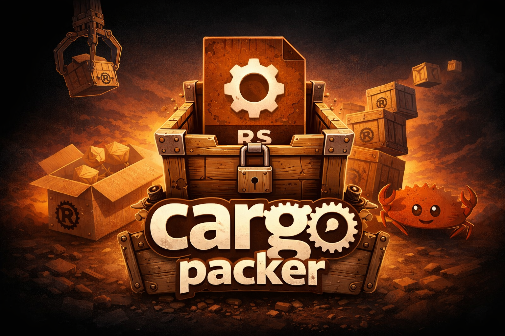

<p align="center">
  
</p>

<p align="center">
  <sub>© 2026 BlancoBAM. Cargo Packer name, logo, and artwork are the property of the project author.</sub>
</p>

---

# Cargo Packer — Firefox Extension

Cargo Packer is a lightweight Firefox extension that allows you to save Rust crate information directly from crates.io pages into structured JSON files for later use.

It is designed for developers who want to quickly collect crate metadata, dependency information, and research notes while browsing.

---

## Features

- One-click crate saving from crates.io
- Automatic metadata extraction:
  - Crate version
  - Description
  - Dependencies
  - Additional crate details
- Optional auto-save when visiting crate pages
- Recent saves history
- Configurable options (include README, metadata fields, etc.)
- Organized local storage in a dedicated downloads directory

---

## Use Cases

Cargo Packer is useful for:

- Building curated Rust package lists before adding them to `Cargo.toml`
- Researching and comparing crates during project planning
- Recording dependency trees for documentation
- Tracking useful libraries discovered while browsing
- Generating structured crate datasets for automation workflows

---

## Installation

### Install from Source (Temporary Add-on)

1. Clone or download this repository
2. Open Firefox and navigate to:

   ```
   about:debugging
   ```

3. Select **This Firefox** in the sidebar
4. Click **Load Temporary Add-on**
5. Choose any file inside the extension directory

---

## Icons

Place the following icon files inside the `icons/` directory:

```
icons/
 ├─ icon-16.png
 ├─ icon-32.png
 ├─ icon-48.png
 ├─ icon-64.png
 ├─ icon-96.png
 └─ icon-128.png
```

---

## Usage

1. Navigate to any crate page on **crates.io**
2. Click the Cargo Packer extension icon
3. Select **Save Current Crate**
4. Saved files will appear in:

```
Downloads/crates/
```

---

## Permissions

The extension requires the following permissions:

- `activeTab` — access crate page content
- `downloads` — save crate files locally
- `storage` — store extension settings

---

## Roadmap

Planned improvements include:

- Chromium-based browser support
- Additional export formats (TOML, YAML, etc.)
- Dependency tree generation
- Automatic saving rules and filters
- Support for additional repositories (GitHub, Bitbucket, Hugging Face, and others)
- Companion extensions for non-crate package ecosystems

---

## License and Branding

© 2026 BlancoBAM. All rights reserved.

The Cargo Packer name, logo, and associated artwork are project identifiers owned by the author. Unauthorized commercial redistribution of the branding assets is not permitted without permission.
